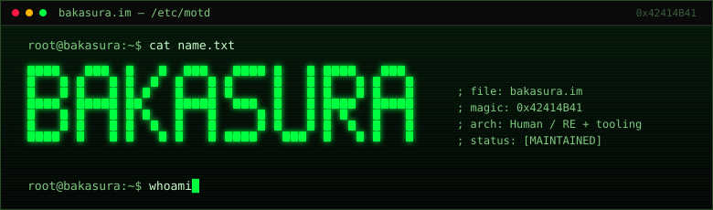

<div align="center">

<a href="https://bakasura.im"></a>

<p><strong>Reverse Engineer / Programmer</strong><br />
<em>Everything else is a target.</em></p>

<p>
<a href="https://bakasura.im"></a>
<a href="https://github.com/BakasuraRCE"></a>
<a href="https://x.com/BakasuraRCE"></a>
<a href="mailto:contact@bakasura.im"></a>
</p>

</div>

## // ABOUT

I take binaries apart and build the tools that put them back together. Mostly Windows PE and game-console
formats, mostly in Python, C and C++ — plus a long-running affair with Delphi, phpBB and self-hosted
infrastructure. I also built and currently maintain **[crackslatinos.org](https://crackslatinos.org)**,
the website that publishes the work of the Spanish-speaking **CrackSLatinoS** group.

- **Reversing** — unpacking, PE internals, static & dynamic analysis, patch tooling
- **Scene work** — preservation tooling for Xbox 360, Usenet and IRC
- **Building** — Python / C / C++ / PHP / Delphi, from CLI utilities to Dockerized services
- **Open to** — collaboration on RE tooling, scene preservation and network protocol work

<div align="center">

<a href="https://github.com/BakasuraRCE?tab=repositories&amp;q=&amp;type=&amp;language=python&amp;sort="></a>
<a href="https://github.com/BakasuraRCE?tab=repositories&amp;q=&amp;type=&amp;language=c&amp;sort="></a>
<a href="https://github.com/BakasuraRCE?tab=repositories&amp;q=&amp;type=&amp;language=c%2B%2B&amp;sort="></a>
<a href="https://github.com/BakasuraRCE?tab=repositories&amp;q=&amp;type=&amp;language=php&amp;sort="></a>
<a href="https://github.com/BakasuraRCE?tab=repositories&amp;q=&amp;type=&amp;language=pascal&amp;sort="></a>
<a href="https://github.com/BakasuraRCE?tab=repositories&amp;q=&amp;type=&amp;language=c%2B%2B&amp;sort="></a>
<a href="https://github.com/BakasuraRCE?tab=repositories&amp;q=&amp;type=&amp;language=dockerfile&amp;sort="></a>
<a href="https://github.com/BakasuraRCE?tab=repositories&amp;q=&amp;type=&amp;language=&amp;sort="></a>
<a href="https://github.com/BakasuraRCE?tab=repositories&amp;q=&amp;type=&amp;language=&amp;sort="></a>

</div>

---

## // SELECTED WORK

### REVERSING & COMMUNITY

| Project | What it does | Stack |
| --- | --- | --- |
| **[UNdUP2](https://github.com/BakasuraRCE/UNdUP2)** | Unpacker and decompiler for the dUP2 patcher: pulls the encrypted DLL out of PE `RCDATA` and decrypts it with a rotative XOR keyed by `0xDEADBEEF`. | `Python` `PE` `XOR` |
| **[crackslatinos.org](https://crackslatinos.org)** | Site I created and currently maintain for the CrackSLatinoS group: courses, tutorials and shared practice of the craft in Spanish. Non-commercial, community around since 2000. | `Web` `Community` `RE` |

### SCENE & PRESERVATION

| Project | What it does | Stack |
| --- | --- | --- |
| **[abgx360 Reloaded](https://abgx360.bakasura.im)** | Hard fork of Seacrest's abgx360. Verifies the integrity of Xbox 360 game backups; HTTPS and Hadzz DB integration in progress. | `C` `Xbox 360` |
| **[steamworks-tracker](https://steamworks.scene.re)** | Indexes every Steamworks SDK release from 1.00 onwards, with SHA-1 and MD5 hashes per binary for verification. | `JSON` `Steam` |
| **[ngPostEx](https://github.com/BakasuraRCE/ngPostEx)** | Fork of ngPost — Usenet binary poster with full article obfuscation, PAR2, folder monitoring and a more reliable `--check`. | `C++` `Qt` |
| **[znc-fishlim-reloaded](https://github.com/BakasuraRCE/znc-fishlim-reloaded)** | FiSHLiM IRC encryption for the ZNC bouncer: CBC and ECB modes, DH1080 key exchange, per-message state indicators. | `Python` `Crypto` |

### INFRASTRUCTURE & WEB

| Project | What it does | Stack |
| --- | --- | --- |
| **[spotweb-docker](https://github.com/BakasuraRCE/spotweb-docker)** | Rootless Spotweb container on OpenLiteSpeed + PHP 8.2, with automatic database schema migration at startup. | `Docker` `PHP` |
| **[phpbb-image-compressor](https://github.com/BakasuraRCE/phpbb-ext-image-compressor)** | Hooks the phpBB upload event and runs PNG attachments through pngquant transparently, updating stored size metadata. | `PHP` `phpBB` |
| **[phpbb-xforwardedfor](https://github.com/BakasuraRCE/phpbb-ext-xforwardedfor)** | Real client IP logging behind reverse proxies — Cloudflare `CF-Connecting-IP` and `X-Forwarded-For` per RFC 7239. | `PHP` `phpBB` |

### DEMOSCENE & DELPHI

| Project | What it does | Stack |
| --- | --- | --- |
| **[pyansilove](https://github.com/BakasuraRCE/pyansilove)** | Python port of libansilove: renders ANSi and ASCII art (ANSI X3.64) to PNG. | `Python` `ANSI` |
| **[TSizeCtrl](https://github.com/BakasuraRCE/TSizeCtrl)** | Non-visual VCL component for runtime move and resize of controls. Fork of Angus Johnson's original. | `Delphi` `VCL` |
| **[LTWaterEffect](https://github.com/BakasuraRCE/LTWaterEffect)** | Water simulation component with 32-bit canvas rendering, ripple physics and StartRain / StopRain control. | `Delphi` `VCL` |
| **[TEditableListView](https://github.com/BakasuraRCE/TEditableListView)** | Extends `TListView` with in-place field editing for Delphi applications. | `Delphi` `VCL` |

<details>
<summary><b>// UPSTREAM & ARCHIVED</b></summary>

| Project | What it does | Stack |
| --- | --- | --- |
| **[hexchat / fishlim #2347](https://github.com/hexchat/hexchat/pull/2347)** | Added CBC mode and extended commands to HexChat's native FiSHLiM plugin. Merged upstream in October 2020; repository archived in 2024. | `C` `IRC` `Crypto` |

</details>

---

## // TELEMETRY

<div align="center">


</div>

---

## // OPEN PORTS

<div align="center">

<a href="https://github.com/BakasuraRCE"></a>
<a href="https://x.com/BakasuraRCE"></a>
<a href="https://discord.com/users/bakasurarce"></a>
<a href="mailto:contact@bakasura.im"></a>

</div>

```text
; built with: markdown + a terminal addiction
; -- EOF --
```
